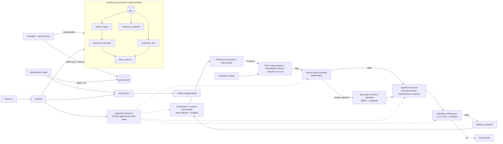

# Arquitetura

## Máquina de estados

`DETECTED → TRIAGED → INVESTIGATING → PLANNED → POLICY_CHECKED → APPROVED/REJECTED → EXECUTING → VALIDATING → RESOLVED/ROLLED_BACK/ESCALATED`

- `PLANNED` só pode ir para `POLICY_CHECKED` e `EXECUTING` só é alcançável a partir de `APPROVED` (testado em `test_no_transition_bypasses_guardian`).
- `REJECTED` e `ROLLED_BACK` voltam a `INVESTIGATING` (replan com feedback) ou `ESCALATED`.
- Qualquer exceção não tratada termina em `ESCALATED`, nunca em `RESOLVED`.

## Decisões técnicas

| Harness sugeriu | Implementado | Motivo |
|---|---|---|
| Airflow + PostgreSQL | DuckDB + DAG runner próprio (`agentops/pipelines.py`) | **BLOCKED**: Docker indisponível no host. Semântica Airflow preservada (deps, `upstream_failed`, run log). ADR-002 |
| LangGraph ou máquina própria | máquina própria | determinística, auditável, sem dependência. ADR-001 |
| OpenTelemetry | JSONL estruturado com `trace_id`/`incident_id`/`strategy_id` e hash-chain | exportável para OTel; sem coletor no host |
| Vários LLMs por papel | **1 chamada estruturada** (RCA + plano) por iteração; demais papéis determinísticos | harness: não presumir que mais LLMs melhoram |
